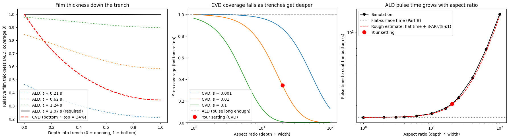

# CVD and ALD Simulator

Python models of how thin films are deposited in semiconductor fabrication. They show what limits film growth in CVD, why ALD is self-limiting, and how well each method coats a deep, narrow trench. The models use placeholder parameters and show trends, not the behavior of a real deposition tool.

## What the models do

**CVD (chemical vapor deposition).** Growth is treated as gas transport and surface reaction in series. The model finds which step is the bottleneck at each temperature and shows how temperature, gas flow, pressure and concentration change the growth rate.

**ALD (atomic layer deposition).** Langmuir saturation kinetics give the pulse time needed to reach a target surface coverage, the number of cycles for a target thickness, and the tradeoff between saturation and process time.

**Trench coverage.** CVD step coverage in a trench (Thiele modulus) is compared with ALD, simulated by stepping the coverage front down the trench over time. The ALD pulse time needed to coat the bottom is calculated as the aspect ratio increases.

## Key results (placeholder parameters)

- CVD at 650 °C is reaction-limited (Damköhler number 0.07). A 50 °C temperature increase raises the growth rate by about 154%, while doubling the gas flow changes it by about 2%. The crossover to transport-limited growth is near 807 °C.
- ALD with a fill rate of 3 per second reaches 99% coverage with a pulse of about 1.5 s, and 102 cycles give a 10 nm film. Total process time is lowest at moderate coverage, but a target near 99% costs only about two more minutes and is less sensitive to dose variations.
- In a trench with an aspect ratio of 20 and a sticking probability of 0.01, CVD coats the bottom to 34% of the top thickness. ALD reaches 99% coverage at the bottom after 2.07 s, compared with 1.53 s on a flat surface.

## How to run

1. Click the **Open in Colab** badge above.
2. Click **Runtime → Run all**.
3. In each slider panel, set your values and click **Run Interact**.

Libraries: numpy, scipy, matplotlib, ipywidgets (all preinstalled in Colab). The trench simulator runs a sweep over aspect ratios, so it can take up to a minute.

## Report

The methods, equations, results and limitations are in [the full report](CVD_and_ALD_Simulator_Report.pdf).

## Limitations

The models are idealized and use placeholder parameters. They were checked against closed-form solutions and against each other, but not against experimental data. CVD uses simplified transport scalings, ALD uses a single Langmuir step with no desorption or temperature window, and the trench model is one-dimensional with first-order wall kinetics.

## Author

Amanda Olivia Seng. Independent personal project, November 2026. 
